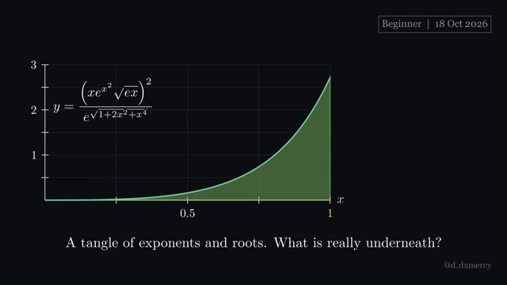
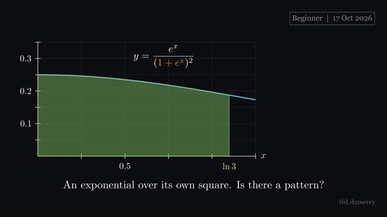
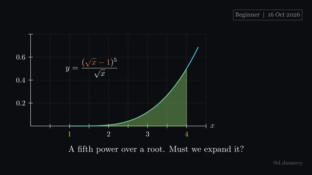
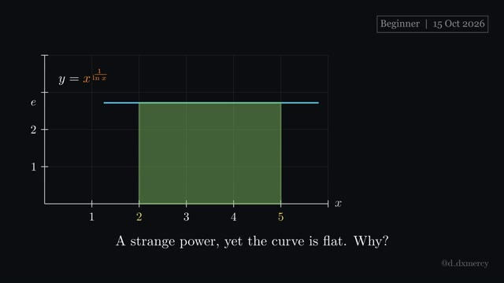
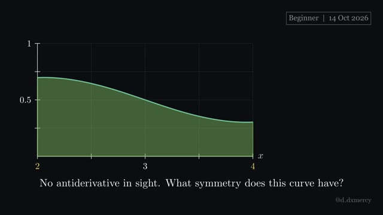
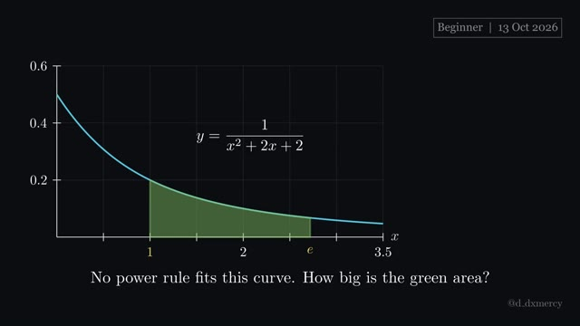
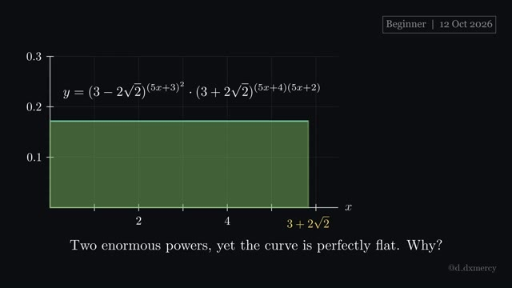
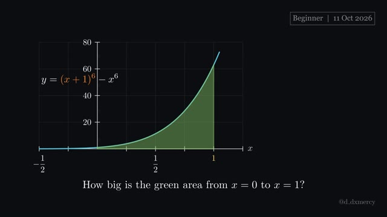
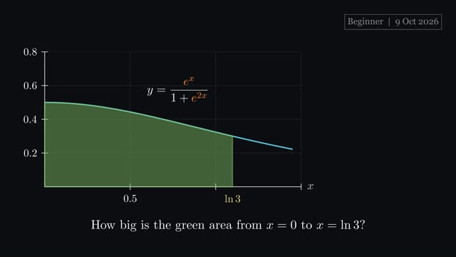
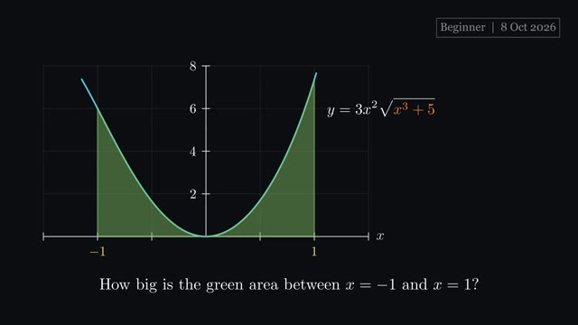

# Beginner integrals

Beginner: one clean technique, shown from the picture up. Newest first; click a thumbnail to watch.

| Video | Integral and answer | Key idea | Files |
|:---:|---|---|---|
|  **2026-10-18** · 2:28 | $\frac{{TOP}}{e^{\sqrt{{SQ}}}}\thinspace dx$  **Answer:** $\frac{1}{2}$ | simplify first; the real integral is often small. | [script](2026-10-18_Beginner.py) [video](https://github.com/hsfhmmni/daily-integral-manim/releases/download/2026-10-18/2026-10-18_Beginner.mp4) [release](https://github.com/hsfhmmni/daily-integral-manim/releases/tag/2026-10-18) [narration](2026-10-18_Beginner_narration.txt) |
|  **2026-10-17** · 2:09 | $\frac{e^{x}}{({INSIDE})^{2}}\thinspace dx$  **Answer:** $\frac{1}{4}$ | a top that is the bottom's derivative invites $u$. | [script](2026-10-17_Beginner.py) [video](https://github.com/hsfhmmni/daily-integral-manim/releases/download/2026-10-17/2026-10-17_Beginner.mp4) [release](https://github.com/hsfhmmni/daily-integral-manim/releases/tag/2026-10-17) [narration](2026-10-17_Beginner_narration.txt) |
|  **2026-10-16** · 2:07 | $\frac{({INSIDE})^{5}}{\sqrt{x}}\thinspace dx$  **Answer:** $\frac{1}{3}$ | spot an inside function whose derivative is also there. | [script](2026-10-16_Beginner.py) [video](https://github.com/hsfhmmni/daily-integral-manim/releases/download/2026-10-16/2026-10-16_Beginner.mp4) [release](https://github.com/hsfhmmni/daily-integral-manim/releases/tag/2026-10-16) [narration](2026-10-16_Beginner_narration.txt) |
|  **2026-10-15** · 1:41 | ${POWER}\thinspace dx$  **Answer:** $3e$ | a variable in the exponent? Rewrite the base as $e^{\ln x}$. | [script](2026-10-15_Beginner.py) [video](https://github.com/hsfhmmni/daily-integral-manim/releases/download/2026-10-15/2026-10-15_Beginner.mp4) [release](https://github.com/hsfhmmni/daily-integral-manim/releases/tag/2026-10-15) [narration](2026-10-15_Beginner_narration.txt) |
|  **2026-10-14** · 2:09 | $\frac{\ln(x^{3}-2)\thinspace e^{\sin x}}{\ln(x^{3}-2)\thinspace e^{\sin x}+\ln((6-x)^{3}-2)\thinspace e^{\sin(6-x)}}\thinspace dx$  **Answer:** $1$ | if $a+b-x$ appears, swap $x$ for it and add. | [script](2026-10-14_Beginner.py) [video](https://github.com/hsfhmmni/daily-integral-manim/releases/download/2026-10-14/2026-10-14_Beginner.mp4) [release](https://github.com/hsfhmmni/daily-integral-manim/releases/tag/2026-10-14) [narration](2026-10-14_Beginner_narration.txt) |
|  **2026-10-13** · 2:32 | $\int_{1}^{e}\frac{1}{x^{2}+2x+2}\thinspace dx$  **Answer:** $\tan^{-1}(e+1)-\tan^{-1}2$ | square plus $1$ on the bottom means inverse tangent. | [script](2026-10-13_Beginner.py) [video](https://github.com/hsfhmmni/daily-integral-manim/releases/download/2026-10-13/2026-10-13_Beginner.mp4) [release](https://github.com/hsfhmmni/daily-integral-manim/releases/tag/2026-10-13) [narration](2026-10-13_Beginner_narration.txt) |
|  **2026-10-12** · 1:42 | $(3-2\sqrt{2})^{(5x+3)^{2}}\cdot(3+2\sqrt{2})^{(5x+4)(5x+2)}\thinspace dx$  **Answer:** $1$ | check whether two bases are reciprocals before integrating. | [script](2026-10-12_Beginner.py) [video](https://github.com/hsfhmmni/daily-integral-manim/releases/download/2026-10-12/2026-10-12_Beginner.mp4) [release](https://github.com/hsfhmmni/daily-integral-manim/releases/tag/2026-10-12) [narration](2026-10-12_Beginner_narration.txt) |
|  **2026-10-11** · 2:47 | $\int_{0}^{1}\Big((x+1)^{6}-x^{6}\Big)\thinspace dx$  **Answer:** $18$ | a shifted power like $(x+1)^{6}$ integrates like $x^{6}$. | [script](2026-10-11_Beginner.py) [video](https://github.com/hsfhmmni/daily-integral-manim/releases/download/2026-10-11/2026-10-11_Beginner.mp4) [release](https://github.com/hsfhmmni/daily-integral-manim/releases/tag/2026-10-11) [narration](2026-10-11_Beginner_narration.txt) |
|  **2026-10-10** · 1:33 | $\int_{1}^{e}x^{2}\ln(x)\thinspace dx$  **Answer:** $\frac{2e^{3}+1}{9}$ | with a logarithm, differentiate it and integrate the rest. | [script](2026-10-10_Beginner.py) [video](https://github.com/hsfhmmni/daily-integral-manim/releases/download/2026-10-10/2026-10-10_Beginner.mp4) [release](https://github.com/hsfhmmni/daily-integral-manim/releases/tag/2026-10-10) [narration](2026-10-10_Beginner_narration.txt) |
|  **2026-10-09** · 1:47 | $\int_{0}^{\ln 3}\frac{e^{x}}{1+e^{2x}}\thinspace dx$  **Answer:** $\tan^{-1}3-\frac{\pi}{4}$ | spot $1+u^{2}$ in disguise, then expect an inverse tangent. | [script](2026-10-09_Beginner.py) [video](https://github.com/hsfhmmni/daily-integral-manim/releases/download/2026-10-09/2026-10-09_Beginner.mp4) [release](https://github.com/hsfhmmni/daily-integral-manim/releases/tag/2026-10-09) [narration](2026-10-09_Beginner_narration.txt) |
|  **2026-10-08** · 1:51 | $\int_{-1}^{1}3x^{2}\sqrt{x^{3}+5}\thinspace dx$  **Answer:** $4\sqrt{6}-\frac{16}{3}$ | spot an inside function whose derivative is also present. | [script](2026-10-08_Beginner.py) [video](https://github.com/hsfhmmni/daily-integral-manim/releases/download/2026-10-08/2026-10-08_Beginner.mp4) [release](https://github.com/hsfhmmni/daily-integral-manim/releases/tag/2026-10-08) [narration](2026-10-08_Beginner_narration.txt) |

[← back to all videos](../README.md)
