# Easy integrals

Easy: a twist on a standard method (symmetry, a substitution in disguise). Newest first; click a thumbnail to watch.

| Video | Integral and answer | Key idea | Files |
|:---:|---|---|---|
| [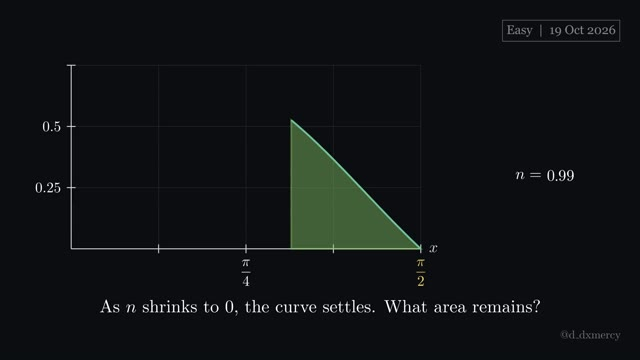](https://github.com/hsfhmmni/daily-integral-manim/releases/download/2026-10-19/2026-10-19_Easy.mp4) **2026-10-19** · 2:17 | ${LIM}\frac{{NUM}}{n\sec(x)}\thinspace dx$  **Answer:** $\frac{1}{2}$ | pull out $\frac{\sin n}{n}$ before taking the limit. | [script](2026-10-19_Easy.py) [video](https://github.com/hsfhmmni/daily-integral-manim/releases/download/2026-10-19/2026-10-19_Easy.mp4) [release](https://github.com/hsfhmmni/daily-integral-manim/releases/tag/2026-10-19) [narration](2026-10-19_Easy_narration.txt) |
| [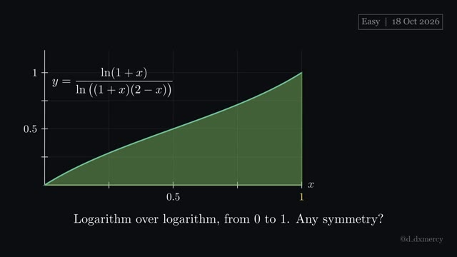](https://github.com/hsfhmmni/daily-integral-manim/releases/download/2026-10-18/2026-10-18_Easy.mp4) **2026-10-18** · 2:04 | $\frac{{L1}}{{PROD}}\thinspace dx$  **Answer:** $\frac{1}{2}$ | if $a-x$ swaps the pieces, add both forms. | [script](2026-10-18_Easy.py) [video](https://github.com/hsfhmmni/daily-integral-manim/releases/download/2026-10-18/2026-10-18_Easy.mp4) [release](https://github.com/hsfhmmni/daily-integral-manim/releases/tag/2026-10-18) [narration](2026-10-18_Easy_narration.txt) |
| [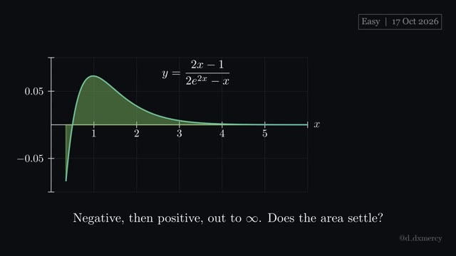](https://github.com/hsfhmmni/daily-integral-manim/releases/download/2026-10-17/2026-10-17_Easy.mp4) **2026-10-17** · 2:18 | $\frac{2x-1}{2e^{2x}-x}\thinspace dx$  **Answer:** $\ln\frac{8}{8-\ln 2}$ | rescale until the top is the bottom's derivative. | [script](2026-10-17_Easy.py) [video](https://github.com/hsfhmmni/daily-integral-manim/releases/download/2026-10-17/2026-10-17_Easy.mp4) [release](https://github.com/hsfhmmni/daily-integral-manim/releases/tag/2026-10-17) [narration](2026-10-17_Easy_narration.txt) |
| [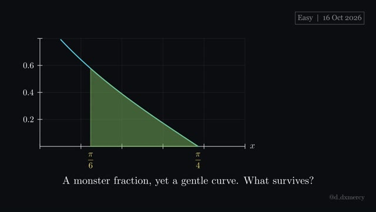](https://github.com/hsfhmmni/daily-integral-manim/releases/download/2026-10-16/2026-10-16_Easy.mp4) **2026-10-16** · 2:34 | $\frac{{N1}{N2}}{{D1}{D2}}\thinspace dx$  **Answer:** $\frac{1}{4}\ln\frac{4}{3}$ | simplify each factor alone before integrating anything. | [script](2026-10-16_Easy.py) [video](https://github.com/hsfhmmni/daily-integral-manim/releases/download/2026-10-16/2026-10-16_Easy.mp4) [release](https://github.com/hsfhmmni/daily-integral-manim/releases/tag/2026-10-16) [narration](2026-10-16_Easy_narration.txt) |
| [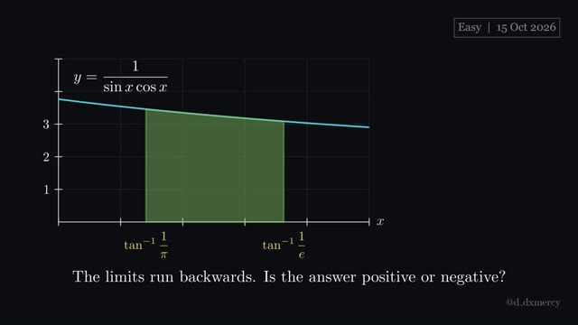](https://github.com/hsfhmmni/daily-integral-manim/releases/download/2026-10-15/2026-10-15_Easy.mp4) **2026-10-15** · 2:25 | $\frac{1}{\sin x\cos x}\thinspace dx$  **Answer:** $1-\ln\pi$ | $\frac{1}{\sin x\cos x}$ is $\frac{\sec^{2}x}{\tan x}$, giving $\ln \tan x $. | [script](2026-10-15_Easy.py) [video](https://github.com/hsfhmmni/daily-integral-manim/releases/download/2026-10-15/2026-10-15_Easy.mp4) [release](https://github.com/hsfhmmni/daily-integral-manim/releases/tag/2026-10-15) [narration](2026-10-15_Easy_narration.txt) |
| [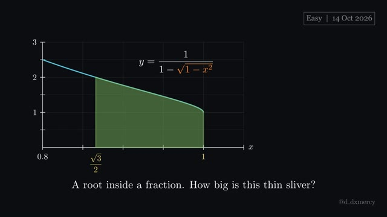](https://github.com/hsfhmmni/daily-integral-manim/releases/download/2026-10-14/2026-10-14_Easy.mp4) **2026-10-14** · 2:31 | $\frac{1}{1-\sqrt{1-x^{2}}}\thinspace dx$  **Answer:** $\sqrt{3}-1-\frac{\pi}{6}$ | $\sqrt{1-x^{2}}$ suggests $x=\sin\theta$, a circle's angle. | [script](2026-10-14_Easy.py) [video](https://github.com/hsfhmmni/daily-integral-manim/releases/download/2026-10-14/2026-10-14_Easy.mp4) [release](https://github.com/hsfhmmni/daily-integral-manim/releases/tag/2026-10-14) [narration](2026-10-14_Easy_narration.txt) |
| [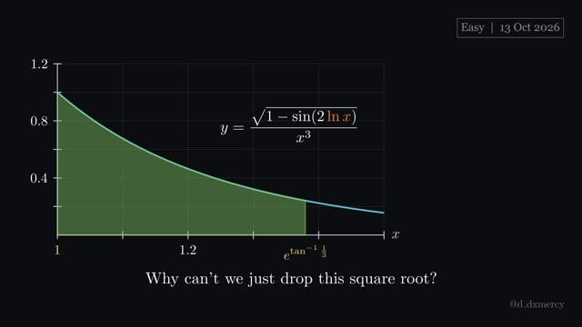](https://github.com/hsfhmmni/daily-integral-manim/releases/download/2026-10-13/2026-10-13_Easy.mp4) **2026-10-13** · 2:57 | $\frac{\sqrt{1-\sin(2\ln x)}}{x^{3}}\thinspace dx$  **Answer:** $\frac{1}{5}$ | $\sqrt{w^{2}}= w $; check the sign before dropping bars. | [script](2026-10-13_Easy.py) [video](https://github.com/hsfhmmni/daily-integral-manim/releases/download/2026-10-13/2026-10-13_Easy.mp4) [release](https://github.com/hsfhmmni/daily-integral-manim/releases/tag/2026-10-13) [narration](2026-10-13_Easy_narration.txt) |
| [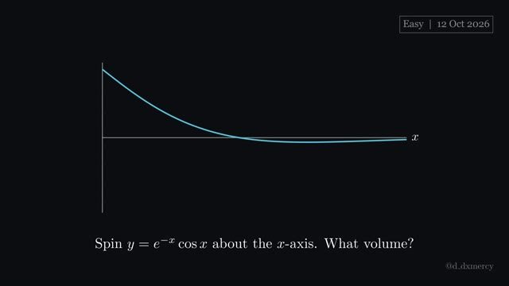](https://github.com/hsfhmmni/daily-integral-manim/releases/download/2026-10-12/2026-10-12_Easy.mp4) **2026-10-12** · 2:52 | $V=\piy^{2}\thinspace dx$  **Answer:** $\frac{3\pi}{8}$ | square first, then a double angle tames $\cos^{2}x$. | [script](2026-10-12_Easy.py) [video](https://github.com/hsfhmmni/daily-integral-manim/releases/download/2026-10-12/2026-10-12_Easy.mp4) [release](https://github.com/hsfhmmni/daily-integral-manim/releases/tag/2026-10-12) [narration](2026-10-12_Easy_narration.txt) |
| [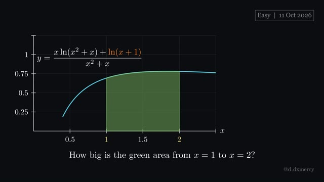](https://github.com/hsfhmmni/daily-integral-manim/releases/download/2026-10-11/2026-10-11_Easy.mp4) **2026-10-11** · 3:31 | $\int_{1}^{2}\frac{x\ln(x^{2}+x)+\ln(x+1)}{x^{2}+x}\thinspace dx$  **Answer:** $\ln 2\cdot\ln 3$ | when terms pair up as $f'g+fg'$, integrate to $fg$. | [script](2026-10-11_Easy.py) [video](https://github.com/hsfhmmni/daily-integral-manim/releases/download/2026-10-11/2026-10-11_Easy.mp4) [release](https://github.com/hsfhmmni/daily-integral-manim/releases/tag/2026-10-11) [narration](2026-10-11_Easy_narration.txt) |
|  **2026-10-10** · 1:60 | $\int_{0}^{\frac{\pi}{2}}\frac{\cos x}{\sec x+\csc x}\thinspace dx$  **Answer:** $\frac{1}{4}$ | on $[0,\frac{\pi}{2}]$, try $x\to\frac{\pi}{2}-x$ and add. | [script](2026-10-10_Easy.py) [video](https://github.com/hsfhmmni/daily-integral-manim/releases/download/2026-10-10/2026-10-10_Easy.mp4) [release](https://github.com/hsfhmmni/daily-integral-manim/releases/tag/2026-10-10) [narration](2026-10-10_Easy_narration.txt) |
| [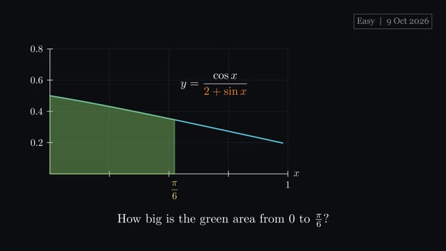](https://github.com/hsfhmmni/daily-integral-manim/releases/download/2026-10-09/2026-10-09_Easy.mp4) **2026-10-09** · 1:44 | $\int_{0}^{\frac{\pi}{6}}\frac{\cos x}{2+\sin x}\thinspace dx$  **Answer:** $\ln\frac{5}{4}$ | when the top is the bottom's derivative, expect a logarithm. | [script](2026-10-09_Easy.py) [video](https://github.com/hsfhmmni/daily-integral-manim/releases/download/2026-10-09/2026-10-09_Easy.mp4) [release](https://github.com/hsfhmmni/daily-integral-manim/releases/tag/2026-10-09) [narration](2026-10-09_Easy_narration.txt) |
| [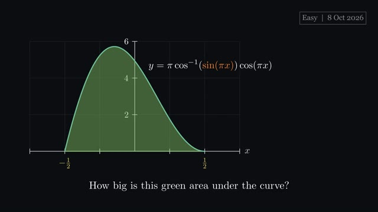](https://github.com/hsfhmmni/daily-integral-manim/releases/download/2026-10-08/2026-10-08_Easy.mp4) **2026-10-08** · 2:04 | $\int_{-\frac{1}{2}}^{\frac{1}{2}}\pi\cos^{-1}(\sin(\pi x))\cos(\pi x)\thinspace dx$  **Answer:** $\pi$ | when a function's derivative sits beside it, substitute. | [script](2026-10-08_Easy.py) [video](https://github.com/hsfhmmni/daily-integral-manim/releases/download/2026-10-08/2026-10-08_Easy.mp4) [release](https://github.com/hsfhmmni/daily-integral-manim/releases/tag/2026-10-08) [narration](2026-10-08_Easy_narration.txt) |

[← back to all videos](../README.md)
