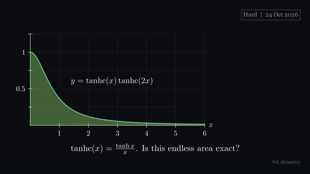
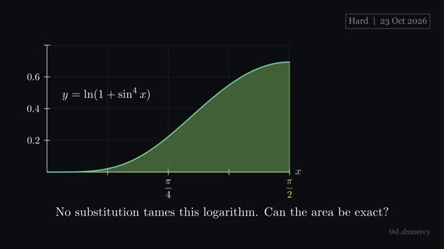
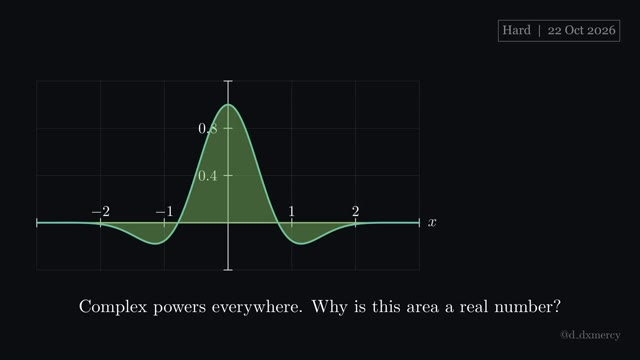

# Hard integrals

Hard: several ideas chained together, for viewers who know the standard techniques. Newest first; click a thumbnail to watch.

| Video | Integral and answer | Key idea | Files |
|:---:|---|---|---|
|  **2026-10-24** · 3:26 | ${TC1}{TC2}\thinspace dx$  **Answer:** $\frac{4G}{\pi}$ | write a function as a blend of waves, then swap. | [script](2026-10-24_Hard.py) [video](https://github.com/hsfhmmni/daily-integral-manim/releases/download/2026-10-24/2026-10-24_Hard.mp4) [release](https://github.com/hsfhmmni/daily-integral-manim/releases/tag/2026-10-24) [narration](2026-10-24_Hard_narration.txt) |
|  **2026-10-23** · 3:28 | $\ln(1+\sin^{4}x)\thinspace dx$  **Answer:** $\pi\ln\frac{1+\sqrt{2}+\sqrt{2+2\sqrt{2}}}{4}$ | give the integral a parameter, then differentiate in it. | [script](2026-10-23_Hard.py) [video](https://github.com/hsfhmmni/daily-integral-manim/releases/download/2026-10-23/2026-10-23_Hard.mp4) [release](https://github.com/hsfhmmni/daily-integral-manim/releases/tag/2026-10-23) [narration](2026-10-23_Hard_narration.txt) |
|  **2026-10-22** · 2:57 | $\frac{e^{-x^{2}}}{(\cosh x+\sinh x)^{1+i}(\cosh x-\sinh x)^{1-i}}\thinspace dx$  **Answer:** $\frac{\sqrt{\pi}}{e}$ | complete the square, then slide the bell back home. | [script](2026-10-22_Hard.py) [video](https://github.com/hsfhmmni/daily-integral-manim/releases/download/2026-10-22/2026-10-22_Hard.mp4) [release](https://github.com/hsfhmmni/daily-integral-manim/releases/tag/2026-10-22) [narration](2026-10-22_Hard_narration.txt) |

[← back to all videos](../README.md)
