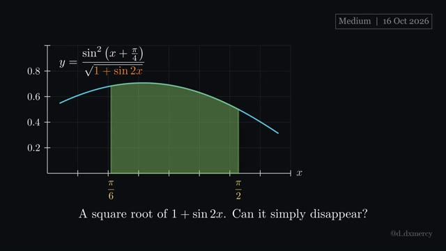
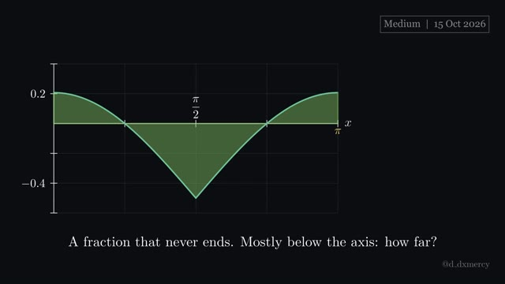
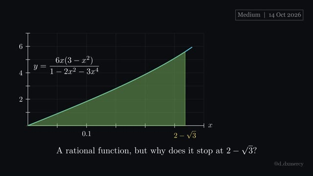
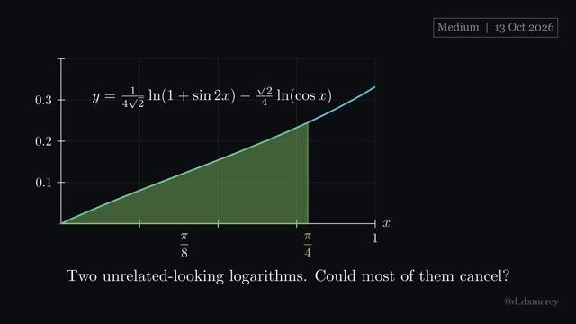
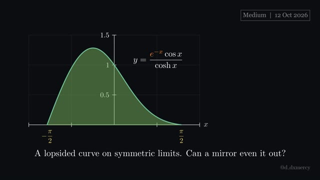
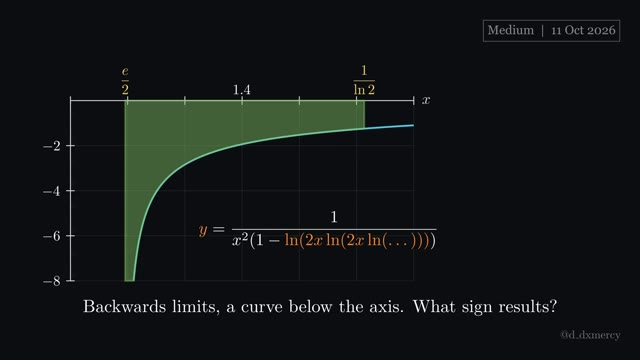
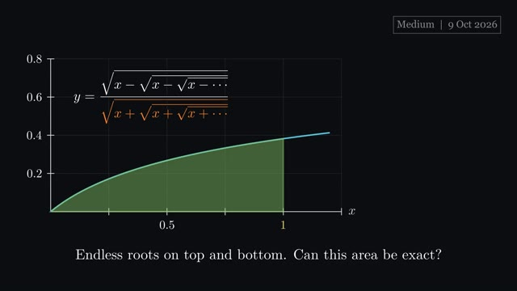
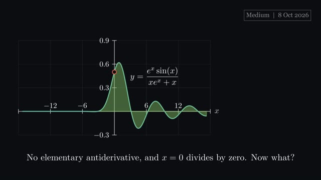

# Medium integrals

Medium: a problem that looks impossible until the right idea appears. Newest first; click a thumbnail to watch.

| Video | Integral and answer | Key idea | Files |
|:---:|---|---|---|
|  **2026-10-16** · 2:09 | $\frac{{SIN2}}{\sqrt{1+\sin 2x}}\thinspace dx$  **Answer:** $\frac{1+\sqrt{3}}{4}$ | $1\pm\sin 2x$ is a square; then mind the absolute value. | [script](2026-10-16_Medium.py) [video](https://github.com/hsfhmmni/daily-integral-manim/releases/download/2026-10-16/2026-10-16_Medium.mp4) [release](https://github.com/hsfhmmni/daily-integral-manim/releases/tag/2026-10-16) [narration](2026-10-16_Medium_narration.txt) |
|  **2026-10-15** · 2:37 | ${REPEAT}}}\thinspace dx$  **Answer:** $\sqrt{2}-\frac{\pi}{2}$ | name the repeating tail, solve for it, mind $\sqrt{\cos^{2}x}$. | [script](2026-10-15_Medium.py) [video](https://github.com/hsfhmmni/daily-integral-manim/releases/download/2026-10-15/2026-10-15_Medium.mp4) [release](https://github.com/hsfhmmni/daily-integral-manim/releases/tag/2026-10-15) [narration](2026-10-15_Medium_narration.txt) |
|  **2026-10-14** · 2:39 | $\frac{6x(3-x^{2})}{1-2x^{2}-3x^{4}}\thinspace dx$  **Answer:** $\ln 2$ | a factor $1+x^{2}$ invites $x=\tan\theta$. | [script](2026-10-14_Medium.py) [video](https://github.com/hsfhmmni/daily-integral-manim/releases/download/2026-10-14/2026-10-14_Medium.mp4) [release](https://github.com/hsfhmmni/daily-integral-manim/releases/tag/2026-10-14) [narration](2026-10-14_Medium_narration.txt) |
|  **2026-10-13** · 2:33 | $\Big(\tfrac{1}{4\sqrt{2}}\ln(1+\sin 2x)-\tfrac{\sqrt{2}}{4}\ln(\cos x)\Big)\thinspace dx$  **Answer:** $\frac{\pi\ln 2}{16\sqrt{2}}$ | on $0$ to $a$, try swapping $x$ for $a-x$. | [script](2026-10-13_Medium.py) [video](https://github.com/hsfhmmni/daily-integral-manim/releases/download/2026-10-13/2026-10-13_Medium.mp4) [release](https://github.com/hsfhmmni/daily-integral-manim/releases/tag/2026-10-13) [narration](2026-10-13_Medium_narration.txt) |
|  **2026-10-12** · 2:20 | $\frac{e^{-x}\cos x}{\cosh x}\thinspace dx$  **Answer:** $2$ | on symmetric limits, add $f(x)$ and $f(-x)$. | [script](2026-10-12_Medium.py) [video](https://github.com/hsfhmmni/daily-integral-manim/releases/download/2026-10-12/2026-10-12_Medium.mp4) [release](https://github.com/hsfhmmni/daily-integral-manim/releases/tag/2026-10-12) [narration](2026-10-12_Medium_narration.txt) |
|  **2026-10-11** · 4:51 | $\int_{\frac{1}{\ln 2}}^{\frac{e}{2}}\frac{1}{x^{2}(1-\ln(2x\ln(2x\ln(\dots))))}\thinspace dx$  **Answer:** $\frac{2}{e}-\frac{1}{2}$ | name a self-repeating tower, then solve for it. | [script](2026-10-11_Medium.py) [video](https://github.com/hsfhmmni/daily-integral-manim/releases/download/2026-10-11/2026-10-11_Medium.mp4) [release](https://github.com/hsfhmmni/daily-integral-manim/releases/tag/2026-10-11) [narration](2026-10-11_Medium_narration.txt) |
|  **2026-10-10** · 1:59 | $\int_{-6}^{6}\Bigg\vert \thinspace \Big\vert \thinspace \big\vert \thinspace \vert x\vert -1\thinspace \big\vert -2\thinspace \Big\vert -3\thinspace \Bigg\vert ^{3}\thinspace dx$  **Answer:** $88$ | unwrap nested absolute values from the inside out. | [script](2026-10-10_Medium.py) [video](https://github.com/hsfhmmni/daily-integral-manim/releases/download/2026-10-10/2026-10-10_Medium.mp4) [release](https://github.com/hsfhmmni/daily-integral-manim/releases/tag/2026-10-10) [narration](2026-10-10_Medium_narration.txt) |
|  **2026-10-09** · 1:56 | $\int_{0}^{1}\frac{\sqrt{x-\sqrt{x-\sqrt{x-\cdots}}}}{\sqrt{x+\sqrt{x+\sqrt{x+\cdots}}}}\hspace{0.28em}\thinspace dx$  **Answer:** $2-\sqrt{5}+\ln\varphi$ | an endless expression contains itself, so write an equation. | [script](2026-10-09_Medium.py) [video](https://github.com/hsfhmmni/daily-integral-manim/releases/download/2026-10-09/2026-10-09_Medium.mp4) [release](https://github.com/hsfhmmni/daily-integral-manim/releases/tag/2026-10-09) [narration](2026-10-09_Medium_narration.txt) |
|  **2026-10-08** · 1:52 | $\int_{-\infty}^{\infty}\frac{e^{x}\sin(x)}{xe^{x}+x}\thinspace dx$  **Answer:** $\frac{\pi}{2}$ | pair $x$ with $-x$ when a weight satisfies $w(x)+w(-x)=1$. | [script](2026-10-08_Medium.py) [video](https://github.com/hsfhmmni/daily-integral-manim/releases/download/2026-10-08/2026-10-08_Medium.mp4) [release](https://github.com/hsfhmmni/daily-integral-manim/releases/tag/2026-10-08) [narration](2026-10-08_Medium_narration.txt) |

[← back to all videos](../README.md)
