# Medium integrals

Medium: a problem that looks impossible until the right idea appears. Newest first; click a thumbnail to watch.

| Video | Integral and answer | Key idea | Files |
|:---:|---|---|---|
| [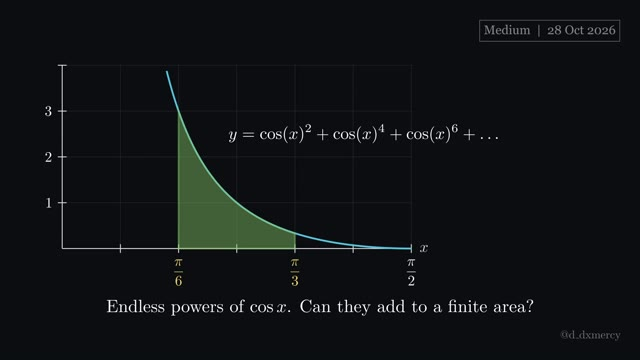](https://github.com/hsfhmmni/daily-integral-manim/releases/download/2026-10-28/2026-10-28_Medium.mp4) **2026-10-28** · 2:04 | $\Big({S}\Big)\thinspace dx$  **Answer:** $\frac{2\sqrt{3}}{3}-\frac{\pi}{6}$ | an endless sum of powers is often a geometric series. | [script](2026-10-28_Medium.py) [video](https://github.com/hsfhmmni/daily-integral-manim/releases/download/2026-10-28/2026-10-28_Medium.mp4) [release](https://github.com/hsfhmmni/daily-integral-manim/releases/tag/2026-10-28) [narration](2026-10-28_Medium_narration.txt) |
| [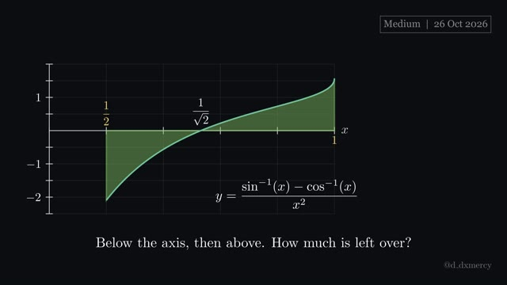](https://github.com/hsfhmmni/daily-integral-manim/releases/download/2026-10-26/2026-10-26_Medium.mp4) **2026-10-26** · 2:48 | $\frac{{NUM}}{x^{2}}\thinspace dx$  **Answer:** $2\ln(2+\sqrt{3})-\frac{5\pi}{6}$ | $\sin^{-1}x+\cos^{-1}x=\frac{\pi}{2}$ turns two inverses into one. | [script](2026-10-26_Medium.py) [video](https://github.com/hsfhmmni/daily-integral-manim/releases/download/2026-10-26/2026-10-26_Medium.mp4) [release](https://github.com/hsfhmmni/daily-integral-manim/releases/tag/2026-10-26) [narration](2026-10-26_Medium_narration.txt) |
| [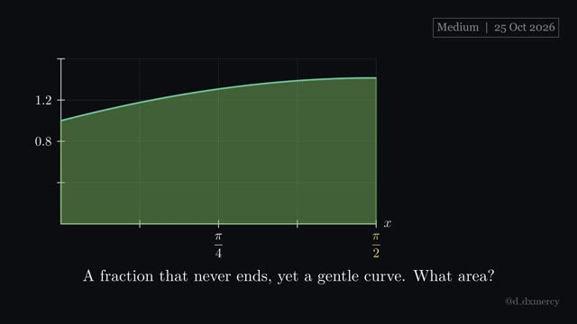](https://github.com/hsfhmmni/daily-integral-manim/releases/download/2026-10-25/2026-10-25_Medium.mp4) **2026-10-25** · 2:37 | $\Bigg(1+\frac{\sin x}{2+{REPEAT}}\Bigg)\thinspace dx$  **Answer:** $2$ | name the repeating tail, then solve for it. | [script](2026-10-25_Medium.py) [video](https://github.com/hsfhmmni/daily-integral-manim/releases/download/2026-10-25/2026-10-25_Medium.mp4) [release](https://github.com/hsfhmmni/daily-integral-manim/releases/tag/2026-10-25) [narration](2026-10-25_Medium_narration.txt) |
| [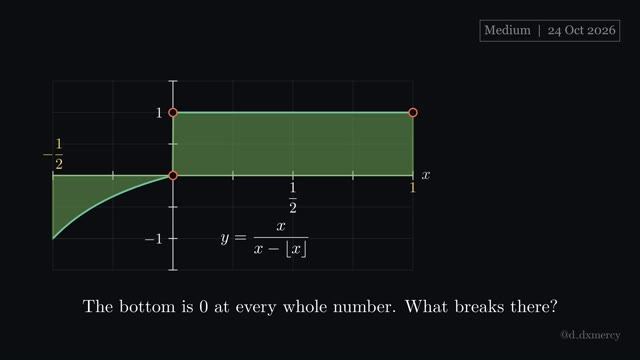](https://github.com/hsfhmmni/daily-integral-manim/releases/download/2026-10-24/2026-10-24_Medium.mp4) **2026-10-24** · 2:06 | $\frac{x}{x-{FLOOR}}\thinspace dx$  **Answer:** $\frac{3}{2}-\ln 2$ | split a floor at its jumps; each piece is ordinary. | [script](2026-10-24_Medium.py) [video](https://github.com/hsfhmmni/daily-integral-manim/releases/download/2026-10-24/2026-10-24_Medium.mp4) [release](https://github.com/hsfhmmni/daily-integral-manim/releases/tag/2026-10-24) [narration](2026-10-24_Medium_narration.txt) |
| [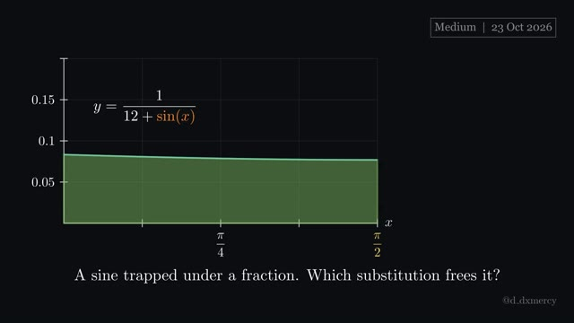](https://github.com/hsfhmmni/daily-integral-manim/releases/download/2026-10-23/2026-10-23_Medium.mp4) **2026-10-23** · 3:15 | $\frac{1}{12+\sin(x)}\thinspace dx$  **Answer:** $\frac{2}{\sqrt{143}}\tan^{-1}\frac{\sqrt{143}}{13}$ | $t=\tan\frac{x}{2}$ turns trig fractions into ordinary fractions. | [script](2026-10-23_Medium.py) [video](https://github.com/hsfhmmni/daily-integral-manim/releases/download/2026-10-23/2026-10-23_Medium.mp4) [release](https://github.com/hsfhmmni/daily-integral-manim/releases/tag/2026-10-23) [narration](2026-10-23_Medium_narration.txt) |
| [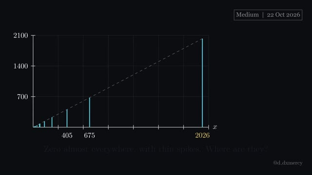](https://github.com/hsfhmmni/daily-integral-manim/releases/download/2026-10-22/2026-10-22_Medium.mp4) **2026-10-22** · 2:28 | $x\Bigg\lfloor\frac{{TOP}}{{BOTTOM}}\Bigg\rfloor\thinspace dx$  **Answer:** $\frac{7517}{2}$ | a floor is constant between integers, so split there. | [script](2026-10-22_Medium.py) [video](https://github.com/hsfhmmni/daily-integral-manim/releases/download/2026-10-22/2026-10-22_Medium.mp4) [release](https://github.com/hsfhmmni/daily-integral-manim/releases/tag/2026-10-22) [narration](2026-10-22_Medium_narration.txt) |
| [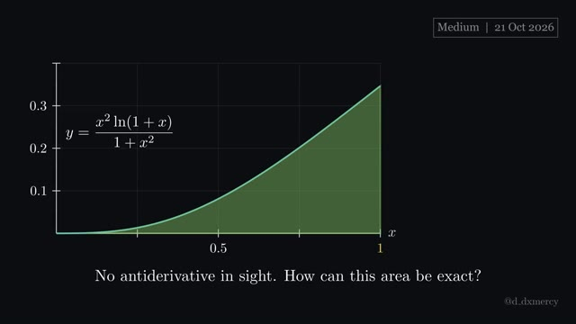](https://github.com/hsfhmmni/daily-integral-manim/releases/download/2026-10-21/2026-10-21_Medium.mp4) **2026-10-21** · 2:56 | $\frac{x^{2}\ln(1+x)}{1+x^{2}}\thinspace dx$  **Answer:** $\frac{\pi}{8}\ln 2$ | after $x=\tan\theta$, try reflecting $\theta$ in the middle. | [script](2026-10-21_Medium.py) [video](https://github.com/hsfhmmni/daily-integral-manim/releases/download/2026-10-21/2026-10-21_Medium.mp4) [release](https://github.com/hsfhmmni/daily-integral-manim/releases/tag/2026-10-21) [narration](2026-10-21_Medium_narration.txt) |
| [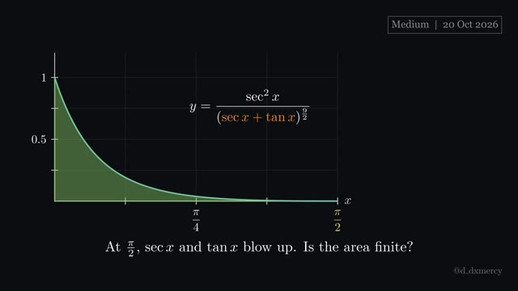](https://github.com/hsfhmmni/daily-integral-manim/releases/download/2026-10-20/2026-10-20_Medium.mp4) **2026-10-20** · 2:37 | $\frac{\sec^{2}x}{({ST})^{\frac{9}{2}}}\thinspace dx$  **Answer:** $\frac{18}{77}$ | $\sec x+\tan x$ and $\sec x-\tan x$ are reciprocals. | [script](2026-10-20_Medium.py) [video](https://github.com/hsfhmmni/daily-integral-manim/releases/download/2026-10-20/2026-10-20_Medium.mp4) [release](https://github.com/hsfhmmni/daily-integral-manim/releases/tag/2026-10-20) [narration](2026-10-20_Medium_narration.txt) |
| [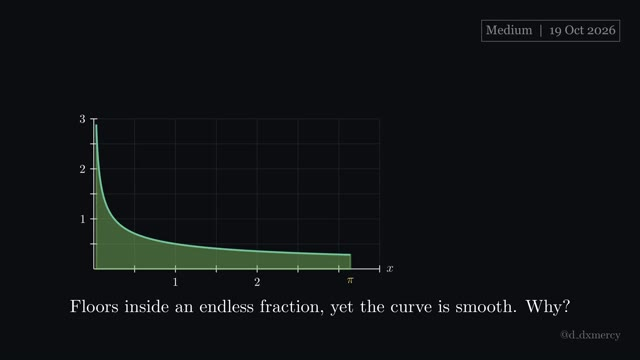](https://github.com/hsfhmmni/daily-integral-manim/releases/download/2026-10-19/2026-10-19_Medium.mp4) **2026-10-19** · 2:36 | $\frac{1}{2}\Bigg({A}+\cfrac{{R}}{2{A}+{REP}}\Bigg)^{-1}\thinspace dx$  **Answer:** $\sqrt{\pi}$ | call the endless tail $y$, then solve $y=g(y)$. | [script](2026-10-19_Medium.py) [video](https://github.com/hsfhmmni/daily-integral-manim/releases/download/2026-10-19/2026-10-19_Medium.mp4) [release](https://github.com/hsfhmmni/daily-integral-manim/releases/tag/2026-10-19) [narration](2026-10-19_Medium_narration.txt) |
| [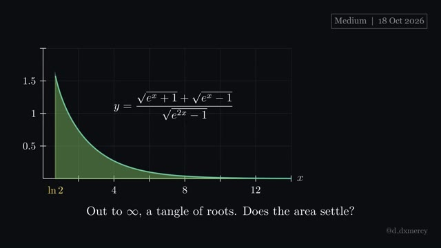](https://github.com/hsfhmmni/daily-integral-manim/releases/download/2026-10-18/2026-10-18_Medium.mp4) **2026-10-18** · 2:56 | $\frac{{A}+{B}}{{BOT}}\thinspace dx$  **Answer:** $\frac{\pi}{2}+\ln(2+\sqrt{3})$ | factor the bottom, split, then substitute each root. | [script](2026-10-18_Medium.py) [video](https://github.com/hsfhmmni/daily-integral-manim/releases/download/2026-10-18/2026-10-18_Medium.mp4) [release](https://github.com/hsfhmmni/daily-integral-manim/releases/tag/2026-10-18) [narration](2026-10-18_Medium_narration.txt) |
| [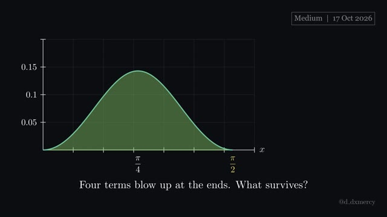](https://github.com/hsfhmmni/daily-integral-manim/releases/download/2026-10-17/2026-10-17_Medium.mp4) **2026-10-17** · 3:27 | $\frac{1}{{SC}+\tan^{2}x+\cot^{2}x+\sec^{2}x+\csc^{2}x}\thinspace dx$  **Answer:** $\frac{\pi\sqrt{14}}{7}-\frac{\pi}{2}$ | identities first, then halve before $\tan$ explodes. | [script](2026-10-17_Medium.py) [video](https://github.com/hsfhmmni/daily-integral-manim/releases/download/2026-10-17/2026-10-17_Medium.mp4) [release](https://github.com/hsfhmmni/daily-integral-manim/releases/tag/2026-10-17) [narration](2026-10-17_Medium_narration.txt) |
|  **2026-10-16** · 2:09 | $\frac{{SIN2}}{\sqrt{1+\sin 2x}}\thinspace dx$  **Answer:** $\frac{1+\sqrt{3}}{4}$ | $1\pm\sin 2x$ is a square; then mind the absolute value. | [script](2026-10-16_Medium.py) [video](https://github.com/hsfhmmni/daily-integral-manim/releases/download/2026-10-16/2026-10-16_Medium.mp4) [release](https://github.com/hsfhmmni/daily-integral-manim/releases/tag/2026-10-16) [narration](2026-10-16_Medium_narration.txt) |
|  **2026-10-15** · 2:37 | ${REPEAT}}}\thinspace dx$  **Answer:** $\sqrt{2}-\frac{\pi}{2}$ | name the repeating tail, solve for it, mind $\sqrt{\cos^{2}x}$. | [script](2026-10-15_Medium.py) [video](https://github.com/hsfhmmni/daily-integral-manim/releases/download/2026-10-15/2026-10-15_Medium.mp4) [release](https://github.com/hsfhmmni/daily-integral-manim/releases/tag/2026-10-15) [narration](2026-10-15_Medium_narration.txt) |
|  **2026-10-14** · 2:39 | $\frac{6x(3-x^{2})}{1-2x^{2}-3x^{4}}\thinspace dx$  **Answer:** $\ln 2$ | a factor $1+x^{2}$ invites $x=\tan\theta$. | [script](2026-10-14_Medium.py) [video](https://github.com/hsfhmmni/daily-integral-manim/releases/download/2026-10-14/2026-10-14_Medium.mp4) [release](https://github.com/hsfhmmni/daily-integral-manim/releases/tag/2026-10-14) [narration](2026-10-14_Medium_narration.txt) |
|  **2026-10-13** · 2:33 | $\Big(\tfrac{1}{4\sqrt{2}}\ln(1+\sin 2x)-\tfrac{\sqrt{2}}{4}\ln(\cos x)\Big)\thinspace dx$  **Answer:** $\frac{\pi\ln 2}{16\sqrt{2}}$ | on $0$ to $a$, try swapping $x$ for $a-x$. | [script](2026-10-13_Medium.py) [video](https://github.com/hsfhmmni/daily-integral-manim/releases/download/2026-10-13/2026-10-13_Medium.mp4) [release](https://github.com/hsfhmmni/daily-integral-manim/releases/tag/2026-10-13) [narration](2026-10-13_Medium_narration.txt) |
|  **2026-10-12** · 2:20 | $\frac{e^{-x}\cos x}{\cosh x}\thinspace dx$  **Answer:** $2$ | on symmetric limits, add $f(x)$ and $f(-x)$. | [script](2026-10-12_Medium.py) [video](https://github.com/hsfhmmni/daily-integral-manim/releases/download/2026-10-12/2026-10-12_Medium.mp4) [release](https://github.com/hsfhmmni/daily-integral-manim/releases/tag/2026-10-12) [narration](2026-10-12_Medium_narration.txt) |
|  **2026-10-11** · 4:51 | $\int_{\frac{1}{\ln 2}}^{\frac{e}{2}}\frac{1}{x^{2}(1-\ln(2x\ln(2x\ln(\dots))))}\thinspace dx$  **Answer:** $\frac{2}{e}-\frac{1}{2}$ | name a self-repeating tower, then solve for it. | [script](2026-10-11_Medium.py) [video](https://github.com/hsfhmmni/daily-integral-manim/releases/download/2026-10-11/2026-10-11_Medium.mp4) [release](https://github.com/hsfhmmni/daily-integral-manim/releases/tag/2026-10-11) [narration](2026-10-11_Medium_narration.txt) |
|  **2026-10-10** · 1:59 | $\int_{-6}^{6}\Bigg\vert \thinspace \Big\vert \thinspace \big\vert \thinspace \vert x\vert -1\thinspace \big\vert -2\thinspace \Big\vert -3\thinspace \Bigg\vert ^{3}\thinspace dx$  **Answer:** $88$ | unwrap nested absolute values from the inside out. | [script](2026-10-10_Medium.py) [video](https://github.com/hsfhmmni/daily-integral-manim/releases/download/2026-10-10/2026-10-10_Medium.mp4) [release](https://github.com/hsfhmmni/daily-integral-manim/releases/tag/2026-10-10) [narration](2026-10-10_Medium_narration.txt) |
|  **2026-10-09** · 1:56 | $\int_{0}^{1}\frac{\sqrt{x-\sqrt{x-\sqrt{x-\cdots}}}}{\sqrt{x+\sqrt{x+\sqrt{x+\cdots}}}}\hspace{0.28em}\thinspace dx$  **Answer:** $2-\sqrt{5}+\ln\varphi$ | an endless expression contains itself, so write an equation. | [script](2026-10-09_Medium.py) [video](https://github.com/hsfhmmni/daily-integral-manim/releases/download/2026-10-09/2026-10-09_Medium.mp4) [release](https://github.com/hsfhmmni/daily-integral-manim/releases/tag/2026-10-09) [narration](2026-10-09_Medium_narration.txt) |
|  **2026-10-08** · 1:52 | $\int_{-\infty}^{\infty}\frac{e^{x}\sin(x)}{xe^{x}+x}\thinspace dx$  **Answer:** $\frac{\pi}{2}$ | pair $x$ with $-x$ when a weight satisfies $w(x)+w(-x)=1$. | [script](2026-10-08_Medium.py) [video](https://github.com/hsfhmmni/daily-integral-manim/releases/download/2026-10-08/2026-10-08_Medium.mp4) [release](https://github.com/hsfhmmni/daily-integral-manim/releases/tag/2026-10-08) [narration](2026-10-08_Medium_narration.txt) |

[← back to all videos](../README.md)
