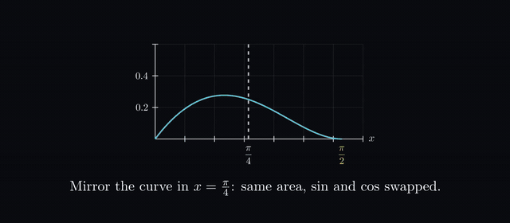
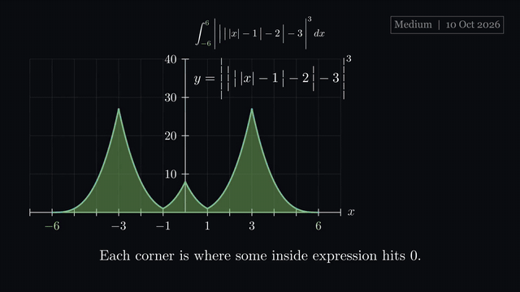
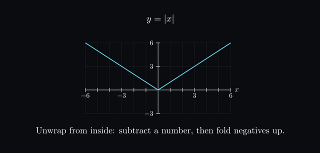
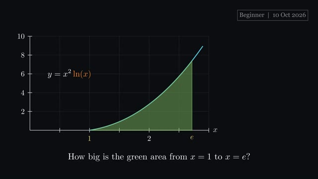
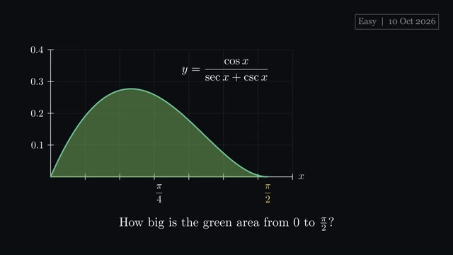
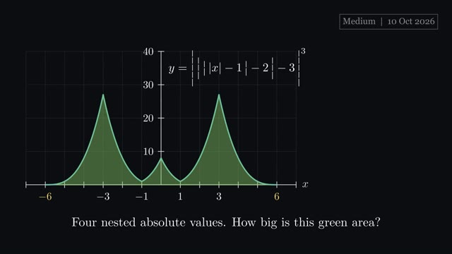
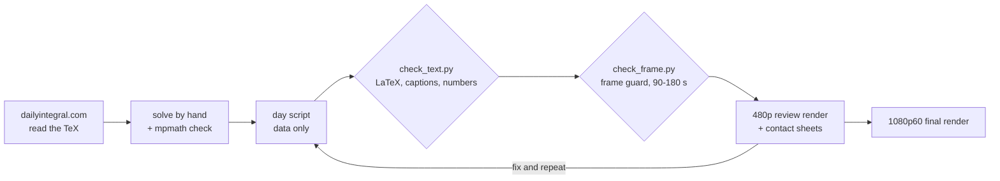

# Daily Integral, animated

**Every day, the [dailyintegral.com](https://dailyintegral.com) Beginner, Easy and Medium integrals, solved and turned into short 3Blue1Brown-style explainer videos with [Manim](https://www.manim.community/).**

    

| Symmetry you can see | Rectangles closing in | Unwrapping nested absolute values |
|:---:|:---:|:---:|
|  |  |  |

Each video starts from the **picture** (the curve and the shaded area) and asks a question. Then it builds intuition with rectangles that get thinner, highlights the one key idea, **morphs** the equations line by line, and ends with the estimate meeting the exact answer.

## Latest: Saturday 10 October 2026

| Beginner | Easy | Medium |
|:---:|:---:|:---:|
| [](https://github.com/hsfhmmni/daily-integral-manim/releases/download/2026-10-10/2026-10-10_Beginner.mp4)<br>$\int_{1}^{e}x^{2}\ln(x)\,dx$<br>**Answer:** $\frac{2e^{3}+1}{9}$ | [](https://github.com/hsfhmmni/daily-integral-manim/releases/download/2026-10-10/2026-10-10_Easy.mp4)<br>$\int_{0}^{\frac{\pi}{2}}\frac{\cos x}{\sec x+\csc x}\,dx$<br>**Answer:** $\frac{1}{4}$ | [](https://github.com/hsfhmmni/daily-integral-manim/releases/download/2026-10-10/2026-10-10_Medium.mp4)<br>$\int_{-6}^{6}\Bigg\vert \,\Big\vert \,\big\vert \,\vert x\vert -1\,\big\vert -2\,\Big\vert -3\,\Bigg\vert ^{3}\,dx$<br>**Answer:** $88$ |

Click a thumbnail for the video (1080p60, about 1.5 to 2 minutes, no sound: the captions carry the story). Every day's videos are also on its [release page](https://github.com/hsfhmmni/daily-integral-manim/releases/tag/2026-10-10).

## All videos

| Date | Beginner | Easy | Medium |
|---|---|---|---|
| **[2026-10-10](https://github.com/hsfhmmni/daily-integral-manim/releases/tag/2026-10-10)** | [▶ video](https://github.com/hsfhmmni/daily-integral-manim/releases/download/2026-10-10/2026-10-10_Beginner.mp4) · [code](Beginner/2026-10-10_Beginner.py)<br>$\int_{1}^{e}x^{2}\ln(x)\,dx$ | [▶ video](https://github.com/hsfhmmni/daily-integral-manim/releases/download/2026-10-10/2026-10-10_Easy.mp4) · [code](Easy/2026-10-10_Easy.py)<br>$\int_{0}^{\frac{\pi}{2}}\frac{\cos x}{\sec x+\csc x}\,dx$ | [▶ video](https://github.com/hsfhmmni/daily-integral-manim/releases/download/2026-10-10/2026-10-10_Medium.mp4) · [code](Medium/2026-10-10_Medium.py)<br>$\int_{-6}^{6}\Bigg\vert \,\Big\vert \,\big\vert \,\vert x\vert -1\,\big\vert -2\,\Big\vert -3\,\Bigg\vert ^{3}\,dx$ |
| **[2026-10-09](https://github.com/hsfhmmni/daily-integral-manim/releases/tag/2026-10-09)** | [▶ video](https://github.com/hsfhmmni/daily-integral-manim/releases/download/2026-10-09/2026-10-09_Beginner.mp4) · [code](Beginner/2026-10-09_Beginner.py)<br>$\int_{0}^{\ln 3}\frac{e^{x}}{1+e^{2x}}\,dx$ | [▶ video](https://github.com/hsfhmmni/daily-integral-manim/releases/download/2026-10-09/2026-10-09_Easy.mp4) · [code](Easy/2026-10-09_Easy.py)<br>$\int_{0}^{\frac{\pi}{6}}\frac{\cos x}{2+\sin x}\,dx$ | [▶ video](https://github.com/hsfhmmni/daily-integral-manim/releases/download/2026-10-09/2026-10-09_Medium.mp4) · [code](Medium/2026-10-09_Medium.py)<br>$\int_{0}^{1}\frac{\sqrt{x-\sqrt{x-\sqrt{x-\cdots}}}}{\sqrt{x+\sqrt{x+\sqrt{x+\cdots}}}}\;\,dx$ |
| **[2026-10-08](https://github.com/hsfhmmni/daily-integral-manim/releases/tag/2026-10-08)** | [▶ video](https://github.com/hsfhmmni/daily-integral-manim/releases/download/2026-10-08/2026-10-08_Beginner.mp4) · [code](Beginner/2026-10-08_Beginner.py)<br>$\int_{-1}^{1}3x^{2}\sqrt{x^{3}+5}\,dx$ | [▶ video](https://github.com/hsfhmmni/daily-integral-manim/releases/download/2026-10-08/2026-10-08_Easy.mp4) · [code](Easy/2026-10-08_Easy.py)<br>$\int_{-\frac{1}{2}}^{\frac{1}{2}}\pi\cos^{-1}(\sin(\pi x))\cos(\pi x)\,dx$ | [▶ video](https://github.com/hsfhmmni/daily-integral-manim/releases/download/2026-10-08/2026-10-08_Medium.mp4) · [code](Medium/2026-10-08_Medium.py)<br>$\int_{-\infty}^{\infty}\frac{e^{x}\sin(x)}{xe^{x}+x}\,dx$ |

Browse by level: [Beginner](Beginner/README.md) · [Easy](Easy/README.md) · [Medium](Medium/README.md)

## How one video is built

Every day's script is **mostly data** (the integral, the steps as LaTeX parts, short captions). The shared engine in [`common.py`](common.py) (`IntegralVideo`) turns it into the same six-beat story:

1. **Intro card**: difficulty, date and the integral.
2. **Hook**: the curve is drawn and the area shaded *before* any formula, with a question. The curve's label then glides into the integral.
3. **Intuition**: 4, 8, 16, 32 and 64 rectangles, with a live estimate and the gap shrinking.
4. **Insight**: the key sub-expression is circled, boxed and labelled while the camera zooms in.
5. **Method**: each line morphs into the next (`TransformMatchingTex`), and earlier lines stay as a dimmed trail. Substitutions show the same area under the new variable; symmetry steps show the reflection.
6. **Close**: the boxed answer, thousands of rectangles meeting it, and a one-line takeaway.

A fixed colour code runs through every video: curve **blue**, area **green**, limits **yellow**, the new variable **orange**, traps **red**.



## Quality gates

Nothing is rendered until both automatic checks pass:

- **[`check_text.py`](check_text.py)**: no maths written as plain words, every caption has 12 words or fewer, every LaTeX string compiles, the stated answer matches an `mpmath` numerical integral, and the 64-rectangle estimate shown on screen is within 1%.
- **[`check_frame.py`](check_frame.py)**: a dry run with a frame guard that fails on anything outside the safe area, overlapping text or text that is too small, plus a 90 to 180 second length check. With `--frames` it saves stills of every key moment as contact sheets for a final look.

## Repository layout

```
daily-integral-manim/
├── common.py            the story engine (IntegralVideo) and helpers
├── check_text.py        text, LaTeX and numeric checks
├── check_frame.py       frame guard, length check, key-moment stills
├── test_helpers.py      one tiny test scene per helper
├── render.bat           checks, then review or final renders
├── Beginner/  Easy/  Medium/
│   ├── README.md        every video at that level
│   ├── YYYY-MM-DD_Level.py              the day's script (mostly data)
│   └── YYYY-MM-DD_Level_narration.txt   the captions as a read-aloud script
├── assets/              thumbnails and preview GIFs
└── docs/STYLE_NOTES.md  the 3Blue1Brown techniques used, and how each is done in Manim CE
```

The videos themselves (1080p60 .mp4) are attached to one [GitHub Release per day](https://github.com/hsfhmmni/daily-integral-manim/releases), tagged with the date, so the repository stays small.

## Run it yourself

You need Python 3.10+, a LaTeX distribution ([MiKTeX](https://miktex.org) or TeX Live) and FFmpeg.

```bash
git clone https://github.com/hsfhmmni/daily-integral-manim.git
cd daily-integral-manim
python -m venv .venv
.venv\Scripts\pip install -r requirements.txt
python check_text.py 2026-10-10
manim -ql Easy/2026-10-10_Easy.py EasyIntegral
```

## Credits

- Problems: [dailyintegral.com](https://dailyintegral.com) and the people who submit problems to it. This project is not affiliated with the site.
- Style: inspired by Grant Sanderson's [3Blue1Brown](https://www.3blue1brown.com/) videos. The techniques are re-implemented from scratch in Manim Community Edition (see [docs/STYLE_NOTES.md](docs/STYLE_NOTES.md)); no 3Blue1Brown code or assets are used.
- Built with [Manim Community Edition](https://www.manim.community/), NumPy and mpmath.

## License

Code: [MIT](LICENSE). Videos: © the author, shared for viewing and learning.
