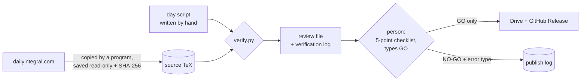

# How every video is verified

A common weakness of automated pipelines, and the way this one first worked, is checking work
against itself: the same author writes the solution and the "expected answer", and the check
confirms the two agree. That proves very little. If the problem was copied wrongly at the start, every later number
agrees with the wrong copy, and every check passes.

This project was rebuilt (October 2026) around one rule: **a check is only evidence if it
could have failed.** Nothing is compared with something written by the same hand, and nothing
is published until a person has watched it and typed `GO`.

## What is different

### 1. One source of truth that nobody types
`fetch_source.py` opens the problem page in a headless browser and saves the website's own
LaTeX and date, once, read-only, with a SHA-256 fingerprint. A copying mistake cannot enter,
because no person copies anything, and an edit made later is detected.

Some days the problem is a word problem with no integral on the page ("find the area of the
region bounded by ..."). Then the saved source is the statement itself, and `verify.py`
turns the words into the integral: the area between two graphs (a line may be given by two
points, the walls are x = a and x = b or else where the graphs meet) or that region rotated
about the x-axis. A statement it cannot read is never guessed: the video is flagged.

Harder problems (from 2026-10-21) can use floors, `mod` and infinite sums, for example
the binary digits of x summed inside a logarithm. `verify.py` reads `\lfloor x\rfloor`,
`\lceil x\rceil` and `\operatorname{mod}(a, b)` as the real functions, and adds up a sum term
by term until it stops changing. A sum with floors or `mod` in it is never extrapolated,
because its terms jump about. Notation that SymPy used to misread without complaint is now
refused instead: `\{x\}` (it read `\{2.5\}` as 2.5), `a \bmod b` and any unknown
`\operatorname{...}`. Infinite products (`\prod`) are refused too.

From 2026-10-24 it also reads `\operatorname{sech}` (with `csch` and `coth`) and the cardinal
functions the website defines, such as `\operatorname{tanhc}(x) = \tanh(x)/x`. A video may name a
well-known constant by its letter (Catalan's constant G, for example), but only from a short fixed
list, and the value always comes from SymPy, never from the script.

### 2. Every check compares the script with that source, not with itself
`verify.py` reads the saved TeX with SymPy and checks, independently:

| What is checked | How |
|---|---|
| The integral shown on screen | same limits, same integrand at 20 random points |
| The function used for the graph and rectangles | equal to the website's integrand at 20 random points |
| The function inside the "exact" integral | intercepted as it is handed to mpmath, then compared at 20 points |
| The boxed answer **as displayed** | the on-screen LaTeX is parsed and evaluated, not just the stored number |
| The date | the date printed on the website |

A sign error copied consistently into every part of a script passes all of the old checks
(the script agrees with itself perfectly). Here it fails six independent checks.

### 3. Two independent integration methods, from the website's integrand only
The reference value is computed twice: by mpmath (tanh-sinh quadrature) and by SciPy
(QUADPACK, adaptive Gauss-Kronrod). They choose their sample points in unrelated ways, so a
silent failure of one (a missed spike, an oscillating tail) shows up as a disagreement and the
video is flagged. Both are built for the hard cases seen in past problems: the range is split
at the corners of nested `|...|` and at the jumps of floor, `mod` and sign, and integrals that oscillate to infinity use methods made
for them (`mpmath.quadosc`; SciPy over half-periods with repeated averaging).

### 4. Tolerances that cannot be gamed by a small answer
Comparisons use **relative** error (below 1e-10 for the boxed answer). An absolute tolerance
such as "within 0.000001" would accept any wrong answer smaller than 0.000001; this was found
by a test, not assumed (see below). An exact answer of 0, where relative error is undefined,
needs |value| < 1e-14. Numerical results use 1e-8 relative, or 1e-12 times the area under
|f|, so the allowance shrinks with the integral.

### 5. Every step of the working, not just the final answer
Each line of the method is evaluated and must equal the line before it, so a wrong middle
step that still reaches the right answer is caught. The reader handles the notation real
videos use: `2I = ...`, evaluation brackets `[F]_a^b`, two integrals on one line, and functions
without brackets read as a person reads them (`\ln 2\cdot\ln 3`). Before a line is marked
wrong it is recomputed with the second method; it fails only if both agree.

### 6. "Unchecked" is never silent
A line the computer cannot evaluate (notation invented inside one video, a helper quantity,
several statements on one line) is listed by name in the review file and shown again at the
publishing gate. A line deliberately shown as a mistake may be excluded only if it is drawn
in the red "trap" colour **and** gives a reason; the code enforces the colour, it does not
trust the flag.

### 7. A human go/no-go gate, and a record of every decision
`publish.py` blocks a video automatically if its source is missing or changed, any check
failed, a file is missing, its date is wrong, the script or video changed after it was
verified, or it was already published. Otherwise the reviewer answers five questions
(watched it all; the integral matches the website; the boxed answer is right; every step
follows; captions and cards have no maths errors) and must type exactly `GO`. Anything else,
including `go` or `GO ` with a space, holds it back with a reason and an error type. Only
approved videos move to the folders that are synced and released, so a rejected video
cannot travel with an approved one. After publishing, the Drive copy and every GitHub
Release asset are compared with the approved file by SHA-256 (GitHub reports each asset's
digest), so what is online is byte for byte what was reviewed. Every check and decision is logged, and `summary.py`
reports the first-attempt pass rate and the most common error types, which show where the
next automatic check is needed.

## Evidence

**Tests that break things on purpose** (64, all passing). Among them:

| Deliberate mistake | Caught by |
|---|---|
| Sign copied wrongly into the integral on screen | integral on screen vs website |
| The same sign error copied everywhere (self-consistent) | six checks at once |
| Boxed answer typo (16 written as 8) | boxed answer as displayed |
| Wrong middle step that still reaches the right answer | step-by-step check (only that line fails) |
| Graph function and "exact" integral disagree | point comparisons |
| Wrong date | date check |
| Answer of 6 × 10⁻²² stated as twice its value | relative tolerance; **missed at first**, fixed |
| Anything but exactly `GO`; publishing twice; a failed check; a missing source | publishing gate |

The tiny-answer case is worth stating plainly: the first version compared the stored answer
with the reference using a fixed allowance of 10⁻¹², which is larger than the whole answer.
A test exposed it, and the allowance now scales with the size of the integral.

**Run over every past video.** The checker was run over all earlier scripts (about 150 lines
of working). The first run wrongly failed 11 correct lines, all misreadings of notation by
the checker itself; after fixing the reader, 130 lines are verified, 0 are wrongly failed, and
the remaining 19 are listed as unchecked because they use notation defined only in their video.

## What it still cannot catch

- **Wrong reasoning with a right number.** A caption can give the wrong reason ("by
  symmetry...") while every value is correct. Values are checked; reasoning is reviewed by a
  person.
- **Visual errors.** A misleading picture or a graph that does not match the maths passes the
  layout checks. The reviewer watches the whole video.
- **Unchecked lines.** They are listed, not verified; the reviewer reads them.
- **A wrong source.** If the website itself had a typo, or the page layout changed and the wrong
  formula were captured, every check would agree with it. The checklist asks the reviewer to
  compare the integral on screen with the website.
- **The checker's own mistakes.** `verify.py` is written by the same author as the videos, so it
  can share a misunderstanding. The tests, the run over past videos and the human gate are the
  defences; a suspected checker error blocks publishing until it is fixed.
